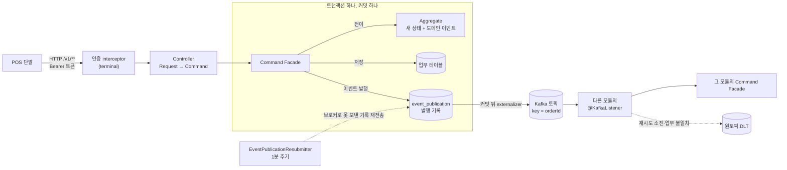
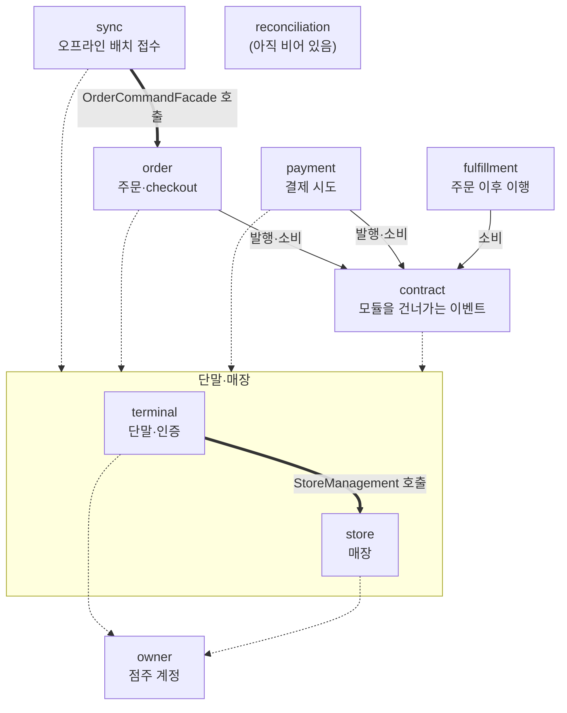

# ResilientPOS

ResilientPOS는 네트워크 단절과 부분 실패 속에서도 주문·결제 상태가 중복 없이 수렴하는 Offline-First POS 플랫폼입니다.

## 기술 스택

현재 빌드에 선언된 기술입니다. 버전은 [빌드 설정](build.gradle.kts)과 [Gradle Wrapper](gradle/wrapper/gradle-wrapper.properties)를 기준으로 합니다.

| 영역 | 기술 |
|---|---|
| 언어 / JVM | Kotlin 2.4.10 / Java 25 toolchain |
| 프레임워크 | Spring Boot 4.1.1 |
| 모듈 경계 / 이벤트 | Spring Modulith (모듈 검증, Event Publication Registry, Kafka externalization) |
| 웹 / 보안 | Spring MVC, Spring Security, Spring Session Data Redis |
| 데이터 접근 | Spring Data JPA, Kotlin JDSL, Flyway, Jackson Kotlin |
| 저장소 / 메시징 | PostgreSQL, Redis (Spring Data Redis), Apache Kafka (Spring Kafka) |
| 운영 상태 확인 | Spring Boot Actuator, Micrometer Prometheus registry, Micrometer Tracing(OpenTelemetry), kotlin-logging |
| 테스트 | Kotlin Test, JUnit 5, Spring Boot Test, Testcontainers, Fixture Monkey, Spring REST Docs, ArchUnit |
| 빌드 | Gradle Wrapper 9.7.1, Kotlin DSL |
| 개발 하네스 | Python 3 표준 라이브러리 기반 로컬 PR 검사 |

단일 Gradle 프로젝트이고, 모듈 경계는 Spring Modulith 검증 테스트가 지킵니다. 주문·결제 정합성의 정본은 PostgreSQL 제약이고 스키마는 Flyway 마이그레이션이 소유합니다.
Redis는 세 가지에만 씁니다. 하나는 중복 요청과 주기 작업의 pod 간 겹침을 줄이는 분산 락(`platform.Lock`)이고, Redis 장애 때는 잠그지 않고 진행하며 DB 제약이 막습니다. 둘째는 점주 세션과 로그인 실패 카운터입니다. 셋째는 인증된 단말 요청의 단말·매장 빈도 상한이고, Redis 장애 때는 제한 없이 통과시킵니다.
metric·로그·trace(OpenTelemetry, 요청에서 Kafka consumer까지 하나로 이어짐)를 내보내고, 알림 규칙은 `docker/prometheus/alerts.yaml`, 알림이 울렸을 때의 절차는 [runbook](docs/wiki/runbook.md)에 있습니다. 자세한 것은 [관측성](docs/wiki/observability.md)에 있습니다.

## 아키텍처

한 번 배포하는 Spring Boot 애플리케이션 하나를 Spring Modulith 모듈로 나눈 모듈형 모놀리스입니다. 상태 변경과 이벤트 발행 기록은 PostgreSQL 커밋 하나에 묶고, 모듈 사이는 커밋 뒤 Kafka 이벤트로 잇습니다. 시퀀스 도식, 실패 경로, 이벤트 스토밍 과정, 모듈별 공개 API는 [아키텍처 상세](docs/wiki/architecture.md)에 있습니다. 아래 그림은 main 808aed9의 코드에서 옮겼습니다.

### 요청에서 Kafka 이벤트까지



1. 단말이 `/v1/**`를 Bearer 토큰으로 부르면 `terminal` 모듈의 interceptor가 토큰을 단말 credential과 대조합니다. 점주 경로 `/owner/**`는 세션 쿠키로, 플랫폼 운영자 경로 `/admin/**`(DLT 재투입·폐기 표시)는 사내 IdP가 발급한 Bearer 토큰으로 인증합니다.
2. Controller는 요청을 Command로 바꾸기만 합니다. Command Facade가 트랜잭션을 열고, 행을 잠가 읽고, aggregate 전이를 부르고, 저장하고, 이벤트를 발행합니다.
3. 업무 행과 이벤트 발행 기록(Spring Modulith Event Publication Registry)이 한 커밋에 들어갑니다. 그래서 "상태는 바뀌었는데 이벤트가 사라짐"이 생기지 않습니다.
4. 커밋 뒤 Modulith가 이벤트를 Kafka로 보냅니다. 보내지 못한 기록은 주기 작업이 1분마다 다시 보냅니다.
5. 받는 모듈의 consumer는 자기 모듈의 Command Facade를 부릅니다. 같은 메시지가 두 번 와도 결과는 하나입니다(unique 제약). 일시적 실패는 같은 자리에서 다시 시도하고, 다시 해도 같은 결과인 실패는 DLT로 보냅니다.
6. 결제 provider 호출은 트랜잭션 밖에서 합니다. 응답이 끊기면 결제를 실패로 확정하지 않고 `UNKNOWN`으로 두었다가 주기 작업이 provider 조회로 확정합니다.

### 모듈 사이 이벤트

| 이벤트 | 내는 모듈 | 토픽 | 받는 모듈 | 받은 뒤 하는 일 |
|---|---|---|---|---|
| `OrderPaymentRequested` | order (checkout 확정) | `order.payment-requested` | payment | 결제 시도 기록 |
| `PaymentEvent.AttemptCreated` | payment | `payment.attempt-created` | payment | provider 승인 요청 |
| `PaymentApproved` | payment (승인, 조회로 승인 확정, 0원) | `payment.approved` | order | 주문 `PAID` 전이 |
| `OrderPaid` | order | `order.paid` | fulfillment | 주문 이행 기록 |

대표 흐름은 `주문 생성 → checkout → OrderPaymentRequested → 결제 시도 → provider 승인 → PaymentApproved → 주문 PAID → OrderPaid → fulfillment`입니다. 단말이 오프라인에서 쌓은 주문·결제 요청은 sync 배치로 들어와 같은 Facade를 거치고, 커밋 뒤에는 같은 이벤트 흐름을 탑니다.

### 모듈과 의존



- 굵은 선은 다른 모듈의 Facade를 직접 부르는 동기 호출, 실선은 `contract` 이벤트 타입, 점선은 식별자(`StoreId` 등)와 인증 값(`AuthenticatedTerminal`)만 쓰는 의존입니다. `단말·매장` 상자로 가는 점선은 `terminal`과 `store` 둘 다에 의존한다는 뜻입니다. 그림에서 뺀 간선이 둘 있습니다. `foundation`(값 타입)에는 `reconciliation`을 뺀 모든 모듈이, `platform`(트랜잭션·락·Kafka 구성 등 공용 인프라)에는 업무 모듈 7개가 의존합니다.
- 간선은 `ApplicationModules.of(ResilientPosApplication::class.java)`가 출력한 모듈 의존을 그대로 옮겼습니다. `order`와 `payment`는 서로 의존하지 않고, `payment`·`fulfillment`에 의존하는 모듈은 없습니다.
- 다른 모듈은 그 모듈의 기본 패키지에 있는 타입(Facade, Command, View, ID, 이벤트)만 쓸 수 있고 `internal` 아래는 쓸 수 없습니다. `ModuleStructureTest`(Modulith 경계·순환 검증)와 `DependencyDirectionTest`(도메인 레이어의 프레임워크 무의존)가 위반을 테스트 실패로 만듭니다.
- `order`와 `payment`는 서로의 사실을 주고받습니다. 이벤트를 각자 두면 서로 의존하는 순환이 되므로 둘이 함께 의존하는 `contract` 모듈에 둡니다.

### 이벤트 스토밍

- 원문 [도메인 청사진](docs/references/05_Domain_Development_Blueprint.md)(2026-09-03)은 주문·결제와 동기화·정산 두 관점의 이벤트 스토밍을 교차 검토한 결과입니다. bounded context 7개와 aggregate, 커맨드 → 이벤트 → 정책 흐름 4개, 커맨드·조회 목록, ADR로 미룬 제품 질문 6개를 남겼습니다. 진행 방식(참가자, 보드)의 기록은 없습니다.
- 저장소는 이 결과를 [도메인 모델](docs/wiki/domain-model.md)로 옮기며 단어를 다시 정했습니다. 예를 들어 `KitchenTicket`은 `Fulfillment`, `TerminalSyncState`는 `Watermark`가 됐고, 응답이 끊긴 결제는 `PaymentFailed`가 아니라 `PaymentUnknown`입니다. 이후 점주 계정 `owner`를 더해 bounded context는 8개입니다.
- 지금 코드에는 주문 → 결제 → fulfillment, 오프라인 sync, `UNKNOWN` 확정 흐름이 있습니다. reconciliation case와 store 판매 정책은 아직 없습니다. 원문과 다르게 정한 것과 구현 여부의 전체 표는 [아키텍처 상세 §5](docs/wiki/architecture.md#5-이벤트-스토밍)에 있습니다.

## 시작하기

클론 직후와 새 worktree를 만든 직후, 에이전트 세션을 시작하기 전에 실행합니다. 스킬·에이전트 정본은 Obsidian 볼트에 있고, 저장소에는 링크만 만듭니다.
규칙(`.claude/rules`)만은 Claude Code가 링크를 싣지 않아 실제 파일로 복사하므로, 볼트 rules를 고친 뒤에도 다시 실행해야 반영됩니다.

```sh
make bootstrap
```

볼트가 없으면 안내만 출력하고 정상 종료하므로 CI와 볼트 없는 머신에서도 안전합니다.
볼트 경로가 다르면 `RESILIENTPOS_VAULT` 환경 변수로 재정의합니다.

## 명령어

모든 작업은 `make` 로 수행합니다. `make help` 로 전체 목록을 확인할 수 있습니다.

| 명령 | 설명 |
| --- | --- |
| `make bootstrap` | 클론·새 worktree 직후, 볼트 rules 수정 후. `.claude`·`.codex` 링크 생성과 rules 복사 |
| `make build` | 애플리케이션 빌드 |
| `make test` | 애플리케이션 테스트 |
| `make harness` | 로컬 하네스 테스트 (Python 표준 라이브러리) |
| `make check` | PR 규칙 검사. 기준 커밋은 `BASE` 로 지정 (`make check BASE=main`) |
| `make up` | 로컬 PostgreSQL·Redis·Kafka 기동 (docker compose) |
| `make down` | compose로 띄운 컨테이너를 profile 구분 없이 모두 중지 |

### 로컬 실행 (docker compose)

Docker 관련 파일은 모두 `docker/` 아래에 있고 로컬 개발 전용입니다. 테스트는 이 파일과 무관하게 Testcontainers로 PostgreSQL·Redis·Kafka를 띄웁니다.

| 명령 | 뜨는 것 |
| --- | --- |
| `make up` | PostgreSQL 18 (`localhost:5432`), Redis 8 (`localhost:6379`), Kafka 4.1 KRaft 단일 노드 (`localhost:9092`) |
| `docker compose -f docker/docker-compose.yaml --profile app up -d --build` | + 앱 컨테이너 (`localhost:8080`, ECS JSON 로그) |
| `docker compose -f docker/docker-compose.yaml --profile app --profile obs up -d --build` | + Alloy, Grafana LGTM (`localhost:3000`, admin/admin) |

DB 비밀번호는 로컬 전용 기본값 `resilientpos` 입니다. 바꾸려면 `cp docker/.env.example docker/.env` 후 값을 고칩니다(`.env` 는 커밋하지 않습니다).
`make up` 뒤 IDE나 `./gradlew bootRun` 으로 앱을 띄울 때는 `POSTGRES_PASSWORD=resilientpos` 를 직접 줍니다. 애플리케이션 설정은 이 값에 기본값을 두지 않습니다.
플랫폼 운영자 IdP 설정도 기본값이 없어 비어 있으면 앱이 뜨지 않습니다. 로컬에는 IdP가 없으므로 자리값 `OPERATOR_ISSUER_URI=http://operator-idp.invalid`, `OPERATOR_AUDIENCE=resilientpos-admin` 을 함께 줍니다(compose의 앱과 같은 값, `/admin` 은 쓸 수 없습니다).
수집 경로는 [관측성](docs/wiki/observability.md)에 있습니다.

### 자동완성 (선택)

`make` 탭 자동완성을 위 명령 목록으로만 제한하려면 `~/.zshrc` 에 다음을 추가하고 새 셸을 엽니다.

```sh
source "<저장소 경로>/scripts/make-completion.zsh"
```

현재 디렉터리의 Makefile 에서 `## ` 주석이 달린 타깃만 완성하며, 해당 컨벤션이 없는 다른
프로젝트에서는 기본 동작으로 폴백합니다.

## 개발 방법론

### SDD — Spec-Driven Development

ResilientPOS는 **PR 단위로 명세를 먼저 작성하고 구현·검증하는 SDD**를 적용합니다.
개발 의도와 완료 기준을 명세에 남기고, 구현 중 결정이 바뀌면 명세와 프로젝트 지식을 함께 갱신합니다.

1. **명세**: 개발 전에 `docs/spec/yyyy-mm-dd-slug.md`에 목적, 범위, 제외 항목, 인수 조건과 검증 방법을 작성하고 독립 커밋으로 기록합니다.
2. **구현**: 한 PR은 개발 컨텍스트 하나입니다. 크기로 나누지 않고, 다른 목표는 별도 spec의 PR로 냅니다.
3. **검증**: 인수 조건에 따라 관련 테스트와 로컬 PR 검사를 실행하고 결과를 spec에 기록합니다.
4. **지식 갱신**: 요구사항·설계 변경은 `docs/wiki` 본문에 반영하고, 그 근거는 해당 PR spec에 남깁니다.

별도 plan 문서 대신 spec에 범위 조정과 개발 이력을 남깁니다. 상세 절차와 PR 단위 기준은 [개발 규칙](docs/wiki/development-workflow.md), 작성 형식은 [spec 템플릿](docs/spec-template.md)에서 관리합니다.

### TDD — Test-Driven Development

SDD의 인수 조건을 **실패하는 테스트 → 최소 구현 → 리팩터링**으로 구체화합니다. 비즈니스·도메인은 단위 테스트를 기본으로 하고, 트랜잭션·이벤트 연결은 필요한 통합 테스트로 검증합니다. Repository 자체 테스트는 대상에서 제외합니다.
Controller는 MockMvc와 Spring REST Docs로 HTTP 계약을 검증하며, fixture 객체는 Fixture Monkey로 생성하고 경계값과 문서 예시는 고정합니다.
저장소의 `resilientpos-tdd` 스킬과 `tdd-driver` 에이전트가 이 과정을 주도하고 결과를 spec에 남깁니다. [테스트 전략](docs/wiki/testing-strategy.md)

### 설계와 검증 방식

- **도메인 중심 설계**: 업무 경계와 데이터 소유권을 기준으로 모듈을 나누고, Aggregate / Value Object에 불변식을 둡니다. 용어 정의와 유비쿼터스 언어 용어집은 [도메인 모델](docs/wiki/domain-model.md)에 있습니다.
- **모듈형 모놀리스**: 단일 배포 구조에서 모듈 경계를 먼저 검증하고, 독립 배포 필요성이 확인될 때 분리합니다.
- **CQRS**: 쓰기 명령과 읽기 조회의 계약을 분리하는 설계 방향을 따릅니다.
- **실패 시나리오 기반 검증**: 정상 흐름과 함께 중복 요청, 응답 유실, 오프라인 복구, 재처리 등 해당 변경에 관련된 실패 조건을 확인합니다.
- **LLM 공통 문서화**: Claude·Codex·Gemini가 같은 spec과 wiki를 참조하며, 상세 문서는 작업에 필요한 범위에서 읽습니다.

아래 원칙은 도메인 구현 시 적용할 설계 기준입니다. 초기 코드에 모두 구현되었다는 의미는 아닙니다.

## Engineering Principles

- **정합성/복구 가능성/관측 가능성 우선**: 기능보다 데이터 정합성과 장애 복구, 운영 가시성을 우선합니다.
- **모듈 경계 준수 (Spring Modulith)**: `owner`, `store`, `terminal`, `order`, `payment`, `sync`, `reconciliation`, `fulfillment` 경계를 지키며 다른 모듈의 internal 코드/DB를 직접 접근하지 않습니다.
- **역할 분리**:
  - Facade: use case + transaction 조합
  - Aggregate / Value Object / Policy: 상태 전이·불변식·금액 계산·검증 소유
  - Service: 도메인 객체 조율만 담당 (DTO 가공/규칙 중복 금지)
- **CQRS 규약**:
  - 쓰기: 모듈 이름공간 아래 use case별 커맨드와 그 안의 결과 (`OrderCommand.Create -> OrderCommand.Create.Result`)
  - 읽기: 쓰기와 같은 이름공간 아래 use case별 조회, 투영 View는 이름공간 밖 (`PaymentQuery.FindAttempts -> PaymentAttemptView`). 조회 Facade는 쓰기 Facade와 따로 두고 port 없이 조회 클래스(Kotlin JDSL, `@ReadOnlyTransactional`)를 부른다
  - 저장소: JPA 엔티티로 aggregate를 저장한다. 간단한 조회는 Spring Data repository, 그 밖의 조회(조인·동적 조건·projection·잠금)는 Kotlin JDSL로 쓴다
- **데이터 정본 원칙**:
  - 주문/결제 정합성 정본: PostgreSQL
  - Redis: cache, rate limit, 짧은 중복 요청 완화, 점주 세션 저장 용도만 사용
  - Redis를 payment idempotency/sync watermark의 정본으로 사용 금지
- **비동기 처리 원칙**:
  - at-least-once 전제
  - 모든 consumer 멱등 보장
  - Event Publication Registry 또는 outbox/inbox 사용
  - 모듈 사이 이벤트는 커밋 뒤 Kafka로 전달하고 재시도·DLT는 브로커 쪽에서 처리 (도입 이유는 [도메인 모델 §8](docs/wiki/domain-model.md#8-참고-사례와-다르게-가는-결정))
- **외부 결제 연동 원칙**:
  - 개인 개발자 test-only 환경으로 제한
  - timeout은 결제 실패 확정이 아님
  - `UNKNOWN -> provider query -> reconciliation` 경로로 수렴
  - 가짜 성공 fallback 금지
- **변경 시 필수 고려사항**:
  - trace, structured log, metric, alert, runbook
  - replay/reconciliation 경로
- **완료 조건**:
  - 정상 흐름 + 실패 시나리오 검증 포함
  - duplicate, timeout, offline sync gap, event replay, Redis/Kafka 장애 테스트 포함

## 문서

- [공통 wiki](docs/wiki/README.md): 현재 지식과 주제별 문서
- [아키텍처 상세](docs/wiki/architecture.md): 요청 처리 단계, 대표 흐름 시퀀스, 실패 경로, 이벤트 스토밍, 모듈 경계
- [개발 규칙](docs/wiki/development-workflow.md): SDD 절차, PR 범위와 로컬 검증
- [Spec 이력](docs/spec): PR별 명세와 검증 기록
- [요구사항 원문](docs/references/README.md): 제공된 기획·설계 자료
