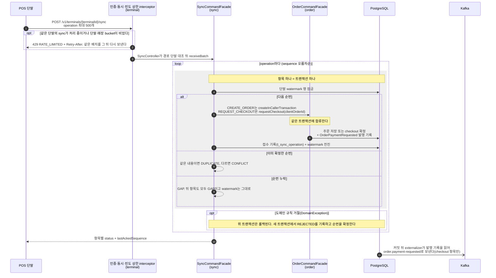
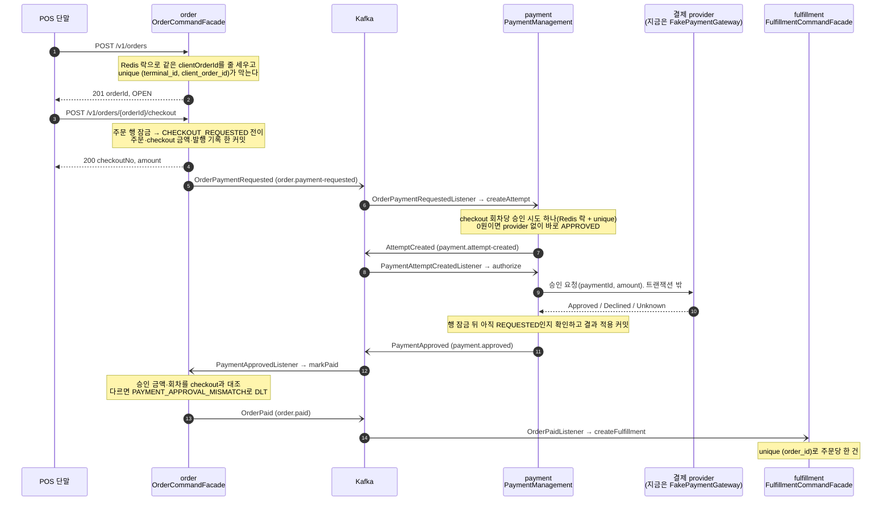
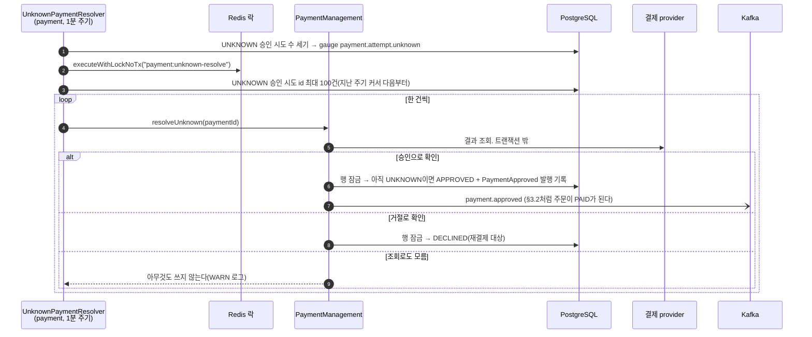
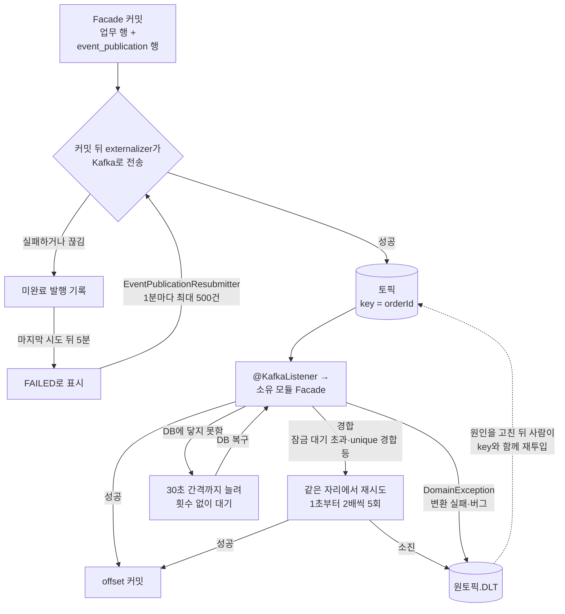

# 아키텍처

요청이 서버 안에서 어디를 지나는지, Kafka 메시지가 어디서 생기고 실패하면 어떻게 되는지, 도메인을 어떻게 찾았는지(이벤트 스토밍), Spring Modulith 모듈을 어떻게 나눴는지를 한곳에 모은 페이지다. 요약 도식(전체 흐름, 모듈 의존 그래프)은 [README의 아키텍처 절](../../README.md#아키텍처)에 있고 여기서는 상세를 다룬다.

기준은 main 808aed9의 코드다. 호출 순서는 각 클래스의 소스에서, 모듈 의존은 `ApplicationModules.of(ResilientPosApplication::class.java)` 출력에서 옮겼다(§6.5). 규칙의 정본은 [도메인 모델](domain-model.md)이고 이 페이지는 그 규칙이 코드에서 어떻게 보이는지를 그림으로 보여 준다. 규칙이 바뀌면 도메인 모델을 먼저 고치고 이 페이지의 그림을 맞춘다.

## 1. 요청 처리 단계

단말(POS)의 쓰기 요청 하나는 아래 순서로 처리된다. 점주 경로(`/owner/**`)는 1번만 다르다. Spring Security 체인(`platform.OwnerSecurityFilterChain`)이 Redis에 둔 세션 쿠키로 인증한다. 플랫폼 운영자 경로(`/admin/**`)는 `platform.AdminSecurityFilterChain`이 사내 IdP가 발급한 Bearer JWT로 인증하고 세션을 쓰지 않는다([platform-operator-dlt-redrive](../spec/2026-10-21-platform-operator-dlt-redrive.md)).

1. **인증.** 단말은 `/v1/**`를 `Authorization: Bearer 토큰`으로 부른다. `terminal` 모듈의 `TerminalAuthenticationInterceptor`가 토큰 형식을 거르고 `TerminalManagement.authenticate`로 토큰 해시를 활성 credential과 대조한다. 성공하면 `AuthenticatedTerminal`(단말 ID, 매장 ID)을 요청 속성에 두고, 실패하면 401 `UNAUTHENTICATED`다. 인증된 요청은 같은 인터셉터에서 동시 요청 상한(`TerminalInFlightLimiter`)과 빈도 상한(`RedisTerminalRateLimiter`)을 차례로 거친다. 동시 요청 상한은 pod 메모리에서 단말마다 sync(`POST /v1/terminals/{terminalId}/sync`) 1개와 그 밖의 쓰기 요청 1개만 처리 중이게 한다. 결제 시도 조회(GET)는 행 잠금을 잡지 않는 읽기라 묶지 않는다. 같은 단말의 같은 묶음이 처리 중이면 Controller에 닿기 전에 429 `RATE_LIMITED`와 `Retry-After: 1`이고, 빈도 token을 쓰지 않는다. 자리는 요청이 끝날 때(예외 포함) 푼다. 이미 통과한 요청에서 인터셉터가 REQUEST가 아닌 dispatch로 다시 불리면(비동기 handler의 ASYNC dispatch) 아무것도 다시 판정하지 않는다. handler가 일한 뒤에 429를 내지 않기 위해서다. 잠금을 기다리며 커넥션을 쥐는 같은 단말의 겹친 요청을 막아, 한 단말의 쓰기 요청이 pod 하나의 커넥션 풀에서 handler 단계에 쥐는 커넥션을 2개 이하로 묶는다. 자리를 잡기 전의 인증 조회는 거절된 요청도 한 번 치른다([terminal-concurrency-limit](../spec/2026-10-23-terminal-concurrency-limit.md)). 빈도 상한은 단말 bucket과 그 매장 bucket(Redis token bucket)을 한 번에 확인해 둘 중 하나라도 비면 Controller에 닿기 전에 429 `RATE_LIMITED`와 `Retry-After`(초)다. `Retry-After`는 같은 요청을 다시 보내도 되는 가장 이른 시각이다. 응답은 동시 거절과 빈도 거절을 가르지 않는다. 거절은 상태를 바꾸지 않으므로 단말은 `error.errorCode`가 `RATE_LIMITED`이면 endpoint와 관계없이 같은 요청을 `Retry-After`에 0~1초 jitter를 더한 뒤 그대로 다시 보낸다. 429·`RATE_LIMITED`는 이 handler 전 거절에만 쓴다. 규약을 HTTP 상태가 아니라 code에 묶는 것은, 나중에 처리 도중의 거절이 429로 나가도 단말이 같은 요청의 재전송으로 다루지 않게 하려는 것이다. Redis 오류면 제한 없이 통과한다(fail-open)([inbound-rate-limit](../spec/2026-10-21-inbound-rate-limit.md)).
2. **Controller.** 경로·본문의 단말과 매장을 `AuthenticatedTerminal`과 대조하고(다르면 403 `TERMINAL_MISMATCH`) Request DTO를 Command로 바꿔 Facade를 부른다. 판단은 하지 않는다.
3. **Command Facade.** use case 하나의 진입점이고 트랜잭션을 연다(`Tx.masterTx`). 행을 잠그고 읽은 뒤 aggregate의 전이 메서드를 부른다.
4. **Aggregate 전이.** aggregate는 자신을 바꾸지 않고 `Transition`(바뀐 새 aggregate와 그 전이가 낸 도메인 이벤트)을 돌려준다([도메인 모델 §4.1](domain-model.md#41-aggregate-상태-전이는-불변-객체가-새-인스턴스를-반환한다)). 불변식 위반은 `DomainException`이다.
5. **저장과 발행, 한 커밋.** Facade가 새 aggregate를 저장하고 이벤트를 모듈 publisher(`OrderEventPublisher` 등)로 발행한다. 트랜잭션 안에서 발행하므로 Spring Modulith가 `event_publication` 테이블(Event Publication Registry)에 발행 기록을 쓰고, 업무 행과 발행 기록이 한 커밋에 들어간다. 기록되는 것은 받는 쪽이 있는 이벤트(`@Externalized`)뿐이다.
6. **응답.** Controller가 Result를 Response DTO로 바꾸고 `platform.ApiResponseBodyAdvice`가 공통 envelope를 씌운다. `DomainException`은 `ApiControllerAdvice`가 `kind`(INVALID·NOT_FOUND·CONFLICT·UNPROCESSABLE·FORBIDDEN)에 맞는 HTTP 상태로 바꾼다.
7. **커밋 뒤 Kafka 발행.** Modulith의 externalizer가 발행 기록을 읽어 토픽으로 보낸다. key는 `orderId`라 같은 주문의 메시지는 한 파티션에 차례로 선다. 보내면 발행 기록이 완료된다.
8. **다른 모듈의 consumer.** 받는 모듈의 `@KafkaListener`는 트랜잭션 없이 자기 모듈의 Command Facade를 부르고, 그 Facade가 다시 3~5번을 한다. 같은 메시지가 두 번 와도 결과는 하나다(unique 제약과 "이미 있으면 돌려준다" 판정).

외부 provider 호출(결제 승인·조회)은 5번의 트랜잭션 밖에서 한다. DB 커넥션을 쥔 채 외부 응답을 기다리지 않고, 호출 결과는 따로 연 트랜잭션에서 행을 잠근 뒤 적용한다.

## 2. Kafka 메시지가 생기는 곳

모듈 사이 이벤트는 넷이고 모두 Kafka를 거친다. 같은 모듈 안에서 받는 `AttemptCreated`도 재시도·DLT를 같은 경로로 받으려고 Kafka를 거친다([도메인 모델 §4.3](domain-model.md#43-이벤트-전달과-저장-형식)).

| 이벤트 | 발행 지점(Facade 메서드) | 토픽 | consumer(모듈) | consumer가 부르는 Facade |
|---|---|---|---|---|
| `contract.OrderPaymentRequested` | `OrderCommandFacade.requestCheckout`(HTTP checkout, sync `REQUEST_CHECKOUT` 항목) | `order.payment-requested` | `OrderPaymentRequestedListener`(payment) | `PaymentManagement.createAttempt` |
| `payment.PaymentEvent.AttemptCreated` | `PaymentManagement.createAttempt`, `retryAuthorization`(재결제) | `payment.attempt-created` | `PaymentAttemptCreatedListener`(payment) | `PaymentManagement.authorize` |
| `contract.PaymentApproved` | `PaymentManagement.authorize`(승인 결과), `resolveUnknown`(조회로 승인 확정), `createAttempt`(0원 주문) | `payment.approved` | `PaymentApprovedListener`(order) | `OrderCommandFacade.markPaid` |
| `contract.OrderPaid` | `OrderCommandFacade.markPaid` | `order.paid` | `OrderPaidListener`(fulfillment) | `FulfillmentCommandFacade.createFulfillment` |

- 토픽은 `application.yaml`의 `resilientpos.kafka.topics` 목록으로 앱이 기동할 때 만들고, 토픽마다 DLT(`이름.DLT`)를 함께 만든다(`platform.KafkaConfiguration`).
- 발행하지만 Kafka로 가지 않는 이벤트도 있다. `OrderEvent.Created`, `PaymentEvent.Declined`, `PaymentEvent.Unknown`은 받는 쪽이 없어 발행 기록도 남지 않는다. 거절·불명이어도 주문은 `CHECKOUT_REQUESTED`에 머물고, 거절은 단말이 재결제(`POST /v1/payment-attempts/{paymentId}/retry`)로, 불명은 `payment`가 provider 조회로 푼다(§3.3).

## 3. 대표 흐름

### 3.1 오프라인 sync 배치

단말이 오프라인에서 만든 명령(operation)을 순번(sequence)과 함께 한 배치로 보낸다. 서버는 항목마다 따로 커밋하고 커밋된 항목만 `APPLIED`로 답한다. 단말은 응답의 항목별 상태와 `lastAckedSequence`(서버가 확정한 마지막 순번)로 무엇을 다시 보낼지 정한다.



- 같은 단말의 배치는 한 pod에서 하나만 처리된다. 겹쳐 온 배치(단말이 timeout으로 끊고 다시 보낸 배치 포함)는 앞 배치가 끝날 때까지 429다. pod가 다르면 배치 둘이 watermark 행 잠금으로 항목 단위로 줄 선다. 이 경로에는 Redis 락이 없다.
- 배치 요청 하나는 빈도 상한에서 요청 하나로 센다. 단말이 쉬는 동안 bucket이 capacity까지 차므로, 오프라인에서 돌아온 단말은 capacity만큼의 배치를 바로 보내고 나머지는 `Retry-After`를 따라 이어 보낸다. 거절된 요청은 토큰을 쓰지 않아 정상 backlog가 영구히 막히지 않는다.
- 단말의 결제 요청은 주문의 checkout 확정이다. 결제 시도 생성은 커밋 뒤 이벤트가 잇는다(§3.2의 7번부터). 그래서 sync는 `payment`를 부르지 않는다.
- 잠금 대기 초과·DB 장애 같은 인프라 실패는 항목 결과가 아니다. 그 항목만 롤백되고 배치 요청이 실패한다. 앞서 커밋된 항목은 재전송 때 `DUPLICATE`로 돌아온다.
- 근거: [sync-intake](../spec/2026-09-30-sync-intake.md), [sync-request-checkout](../spec/2026-09-30-sync-request-checkout.md), [도메인 모델 §4.6](domain-model.md#46-컨텍스트-사이-동기-쓰기는-sync-intake와-대조-해소-둘만-한-트랜잭션으로).

### 3.2 주문 생성 → checkout → 결제 승인 → PAID → fulfillment



- 시도 기록(`createAttempt`)과 provider 호출(`authorize`)을 consumer 둘로 나눴다. 호출이 실패하면 `AttemptCreated` 메시지가 재시도되고 끝내 DLT에 남아 복구 단서가 된다. 한 consumer에 몰면 커밋된 `REQUESTED` 행만 남고 다시 집어들 근거가 없다(`PaymentAttemptCreatedListener` KDoc).
- provider가 거절하면 시도는 `DECLINED`이고 주문은 `CHECKOUT_REQUESTED`에 머문다. 단말이 재결제를 부르면 같은 회차의 새 시도가 생기고 `AttemptCreated`부터 다시 흐른다.
- 근거: [payment-attempt-from-order-event](../spec/2026-09-22-payment-attempt-from-order-event.md), [order-mark-paid](../spec/2026-09-23-order-mark-paid.md), [fulfillment](../spec/2026-09-24-fulfillment.md), [kafka-event-redelivery](../spec/2026-09-26-kafka-event-redelivery.md).

### 3.3 결과 불명(UNKNOWN) 결제의 provider 조회 확정

provider 호출이 끊기거나 시간이 다하면 결과를 모르는 것이지 실패가 아니다. 결제 포트(`PaymentGateway`)는 이때 예외 대신 `Unknown`을 돌려주고 시도는 `UNKNOWN`이 된다. 같은 요청을 다시 보내지 않고 provider에 결과를 물어 확정한다.



- 모든 pod에서 돌고 Redis 락이 pod 사이를 줄 세운다. 락은 중복 조회를 줄이는 완화 수단이다. 락이 풀려 겹쳐도 조회는 읽기이고, 같은 확정이 두 번 적용되는 일은 행을 잠근 뒤 `UNKNOWN`을 다시 확인하는 데서 막힌다.
- 한 건이 실패하면 ERROR 로그를 남기고 다음 건으로 간다. 그 건은 다음 주기에 다시 잡힌다.
- 조회로도 확정되지 않는 건을 넘겨받을 reconciliation case는 아직 없다. `max(payment_attempt_unknown) > 0`이 한 시간 넘게 이어지면 사람이 provider 콘솔에서 확인한다([관측성](observability.md)).
- 근거: [payment-unknown-resolution](../spec/2026-10-01-payment-unknown-resolution.md).

## 4. 실패 경로: 재시도, DLT, 주기 재전송

메시지는 두 군데에서 실패할 수 있다. 커밋 뒤 브로커로 보내는 단계와 consumer가 처리하는 단계다. 어느 쪽이든 메시지를 조용히 버리지 않는다.



- **브로커 전송 실패.** 발행 기록이 미완료로 남는다. `platform.EventPublicationResubmitter`가 1분마다 끊긴 기록(마지막 시도 뒤 5분)을 `FAILED`로 바꾸고, `FAILED` 기록을 오래된 것부터 최대 500건 다시 보내고, 완료 뒤 7일 지난 기록을 지운다. 끝나지 않은 기록 수는 gauge `event_publication_incomplete{status}`로 보인다.
- **consumer 실패.** `platform.KafkaConfiguration`의 `DefaultErrorHandler`가 허용 목록 예외만 다시 시도한다. 그동안 같은 파티션의 뒤 메시지는 기다린다. 목록 밖 예외는 다시 해도 결과가 같아 바로 DLT로 간다. DLT는 보존 기간이 없고, DLT로 보낸 수는 `event_kafka_dead_letter_total{topic, reason}`이다.
- **순서.** 같은 주문의 두 이벤트가 커밋 순서와 다르게 전송될 수 있다. consumer는 순서에 기대지 않고 멱등으로 견딘다.
- 재시도 허용 목록, DLT 재투입 명령, 재전송이 영영 나가지 못하는 기록을 찾는 SQL은 [도메인 모델 §4.3](domain-model.md#43-이벤트-전달과-저장-형식)에 있다.

## 5. 이벤트 스토밍

### 5.1 근거 문서에 남은 과정

- 원문 [도메인 청사진](../references/05_Domain_Development_Blueprint.md)(v1.0, 기준일 2026-09-03)은 목적을 "이벤트 스토밍 결과를 Facade/Service, CQRS, JPA/Kotlin JDSL, Kafka/Redis 구현 규약으로 고정한다"고 적는다. [문서 맵](../references/00_Document_Index.md) 변경 이력 v2.4(2026-09-03)가 이 문서를 "도메인별 이벤트 스토밍 및 교차 검토 결과"로 추가했다.
- 청사진 §2는 aggregate 표를 "주문·결제, 동기화·정산 관점을 교차 검토해 확정한 MVP aggregate map"이라고 설명한다. 두 관점으로 나눠 도출한 뒤 서로 검토해 하나로 맞췄다는 뜻이다.
- 문서에 남은 것은 결과뿐이다. 참가자, 진행 방식, 포스트잇 보드 같은 진행 기록은 저장소에 없다.
- 저장소로 들여온 뒤(2026-09-07) [도메인 모델](domain-model.md)이 이 결과를 정본으로 옮겼다([domain-model-glossary](../spec/2026-09-15-domain-model-glossary.md)). 원문은 참고 자료라 고치지 않고, 단어와 설계를 다르게 정한 것은 도메인 모델의 용어집(§3)과 결정(§4·§8)에 기각한 대안·이유와 함께 남겼다.

### 5.2 도출한 결과

청사진 §2·§3·§4·§9가 남긴 산출물이다.

| 산출물 | 내용 |
|---|---|
| bounded context와 aggregate(§2) | `store`(`Store`), `terminal`(`Terminal`), `order`(`Order`), `payment`(`PaymentAttempt`), `sync`(`TerminalSyncState`), `reconciliation`(`ReconciliationCase`), `fulfillment`(`KitchenTicket`, `ReceiptDelivery`)와 각 불변식. `inventory`는 비목표 |
| 컨텍스트 사이 소유(§2.1) | `Order ─ OrderPaymentRequested → Payment`, `Payment ─ PaymentApproved / Declined / Unknown → Order, Reconciliation`, `Order ─ OrderPaid → Fulfillment`, `Sync ─ accepted command → Order or Payment`. 결제 정본 상태는 `payment`만 바꾸고 `order`와 `payment`는 서로의 테이블을 읽지 않는다 |
| 흐름 넷(§3) | 주문 → 결제, 오프라인 sync, 결제 모호성과 reconciliation, fulfillment. 각 흐름은 `[커맨드] → 이벤트 → policy → [다음 커맨드]` 사슬이다 |
| 커맨드·조회 목록(§4) | 컨텍스트별 Command → Result, Query/Criteria → View |
| 미룬 질문 여섯(§9) | 재고 예약 시점, 오프라인 화면 상태, 분할 결제, 취소·환불 조합, reconciliation 자동 복구 규칙, read model 분리. 구현 전에 ADR로 정할 제품 결정이다 |

예: 청사진 §3.1의 주문 → 결제 흐름.

```text
[RequestCheckout]      → OrderPaymentRequested
                            │ policy
[CreatePaymentAttempt] → PaymentAttemptCreated
[ConfirmPayment]       → PaymentApproved  ─ policy → [MarkOrderPaid] → OrderPaid
                       → PaymentDeclined  ─ policy → [MarkOrderPaymentFailed]
                       → PaymentUnknown   ─ policy → [OpenReconciliationCase]
```

### 5.3 저장소가 다르게 정한 것

| 원문 | 저장소 | 근거 |
|---|---|---|
| `TerminalSyncState`, sync의 `receipt` | `Watermark`, `operation` | receipt가 접수증과 고객 영수증 두 뜻이었다([도메인 모델 §3](domain-model.md#3-유비쿼터스-언어-용어집)) |
| `KitchenTicket` | `Fulfillment` | kitchen·ticket이 업종과 표시 매체를 전제한다(도메인 모델 §3) |
| `CheckoutSnapshot` | `Checkout` | snapshot은 구현 용어이고 이 값은 "N회차 확정 금액"이라는 업무 사실이다(도메인 모델 §3) |
| `PaymentConfirmed`, timeout 때 `PaymentFailed` | `PaymentApproved`, `PaymentUnknown` | 원문이 두 이름을 섞어 썼고, timeout은 결과가 아니라 미확인이다(도메인 모델 §3) |
| 이벤트를 소유 모듈에 둠 | 모듈을 건너가는 이벤트는 `contract` 모듈 | 두 모듈이 서로의 사실을 주고받으면 Modulith 순환 검사에 걸린다([도메인 모델 §4.4](domain-model.md#44-공개-타입은-모듈-루트에-둔다)) |
| 외부 소비자가 생긴 이벤트만 Kafka로 | 모듈 사이 이벤트 넷을 모두 Kafka로 | 여러 pod 운영과 재시도·순서·DLT를 브로커 표준 수단에 맡기려고 앞당겼다. 대가는 로컬·테스트에 브로커가 필요한 것이다(도메인 모델 §8) |
| order 상태 `OFFLINE_CREATED → SYNCED → PAYMENT_PENDING` | 첫 상태는 `OPEN` | 오프라인 생성 여부는 `sync`가 소유하는 사실이다(도메인 모델 §8) |
| `PaymentDeclined → [MarkOrderPaymentFailed]` | 거절은 `payment`에 남고 주문은 `CHECKOUT_REQUESTED`에 머문다 | 그 회차의 결제가 아직 끝나지 않았고 재결제는 같은 회차의 새 시도다(도메인 모델 §2) |
| `PaymentUnknown → [OpenReconciliationCase]` | `payment`의 주기 작업이 provider 조회로 확정 | reconciliation case는 아직 없다([payment-unknown-resolution](../spec/2026-10-01-payment-unknown-resolution.md)) |
| context 7개 | `owner`(점주 계정)를 더해 8개 | 점주가 자기 매장의 단말을 관리하는 API가 생겼다([operator-authentication](../spec/2026-10-06-operator-authentication.md)) |

### 5.4 지금 코드에 있는 것과 없는 것

| 원문의 커맨드 → 이벤트 | 지금 코드 |
|---|---|
| `CreateOrder → OrderCreated` | 있다(`OrderEvent.Created`). 받는 쪽이 없다 |
| `ChangeOrderLine → OrderLineChanged` | 없다 |
| `RequestCheckout → OrderPaymentRequested` | 있다. 원문의 `CheckoutRequested`는 따로 내지 않는다 |
| `CreatePaymentAttempt → PaymentAttemptCreated` | 있다(`PaymentEvent.AttemptCreated`) |
| `ConfirmPayment → PaymentApproved / Declined / Unknown` | 있다(`authorize`). provider는 `FakePaymentGateway`이고 Toss 연동은 없다 |
| `MarkOrderPaid → OrderPaid` | 있다 |
| `ReceiveSyncBatch` → duplicate·gap·conflict·accepted | 있다(항목별 `DUPLICATE`·`GAP`·`CONFLICT`·`APPLIED`·`REJECTED`). `SyncGapDetected`·`SyncConflictDetected`·`SyncOperationApplied` 이벤트는 없고 응답과 WARN 로그로 드러난다 |
| `CreateKitchenTicket → KitchenTicketCreated` | `Fulfillment` 생성은 있고 이벤트는 내지 않는다. `ReceiptDelivery`는 없다 |
| reconciliation의 `OpenCase` 등 | 없다. 모듈은 비어 있다 |
| `ChangeStorePolicy` | 없다. 매장 생성·조회만 있다 |

## 6. Spring Modulith 모듈

### 6.1 모듈과 책임

`com.resilientpos` 바로 아래 패키지 하나가 application module 하나다. 각 패키지의 `package-info.java`에 `@ApplicationModule`과 책임 설명이 있다. Gradle 모듈로 나누지 않은 단일 프로젝트이고, 경계는 Modulith 검증이 지킨다.

| 모듈 | 종류 | 책임 | 공개 API(모듈 루트 타입) |
|---|---|---|---|
| `owner` | bounded context | 점주 계정(이메일, 비밀번호 해시), 가입, 로그인 실패 제한 | `OwnerManagement`, `OwnerCommand`, `OwnerId` |
| `store` | bounded context | 매장과 소유 점주. 판매 정책은 아직 없다 | `StoreManagement`, `StoreCommand`, `StoreView`, `StoreId` |
| `terminal` | bounded context | 단말 코드, 소속 매장, 활성화, credential 회전 이력, 단말 인증, 단말별 동시 요청 상한, 단말·매장 빈도 상한 | `TerminalManagement`, `TerminalQueryFacade`, `TerminalCommand`, `TerminalQuery`, `TerminalView`, `TerminalId`, `TerminalCode`, `TerminalStatus`, `AuthenticatedTerminal` |
| `order` | bounded context | 주문 line, checkout 금액, 주문 lifecycle | `OrderCommandFacade`, `OrderCommand`, `OrderEvent`, `OrderId`, `ClientOrderId`, `OrderStatus` |
| `payment` | bounded context | 결제 시도, provider 결과 적용, 결제 정본 상태 | `PaymentManagement`, `PaymentQueryFacade`, `PaymentCommand`, `PaymentQuery`, `PaymentAttemptView`, `PaymentEvent`, `PaymentId`, `PaymentAttemptStatus` |
| `sync` | bounded context | 단말 watermark, operation 접수·중복 제거, gap·conflict 판정 | 없음. HTTP endpoint만 있다 |
| `fulfillment` | bounded context | 결제된 주문의 이행 | 없음. `OrderPaid`를 소비할 뿐이다 |
| `reconciliation` | bounded context | 불일치 case(예정) | 없음. 아직 비어 있다 |
| `contract` | 계약 | 모듈을 건너가는 이벤트. 업무 규칙과 상태가 없다 | `OrderPaymentRequested`, `PaymentApproved`, `OrderPaid`, `PaymentAttemptKind` |
| `foundation` | 공유 커널 | 프레임워크 없는 값 타입과 모델링 원시 타입 | `Money`, `DomainEvent`, `Transition`, `DomainException`, `IdentifierGenerator` |
| `platform` | 공용 인프라 | 트랜잭션(`Tx`), 분산 락(`Lock`), 엔티티 기반 클래스, 조회 실행기, 응답 envelope·오류 변환, 점주·운영자 Security 체인, Kafka 구성, 발행 기록 재전송·metric, DLT 재투입·폐기 표시 API와 기록, 미처리 DLT metric | `Tx`, `Lock`, `BaseEntity`, `JdslQueryExecutor` 등 |

- **공개 API는 모듈 기본 패키지에 있는 타입이다.** Facade, 커맨드·조회 이름공간, `*View`, ID 값 타입, 이벤트만 둔다. 그 밖은 모두 `internal` 아래다(`internal/domain`, `internal/application`, `internal/adapter/web`, `internal/adapter/persistence/command`·`query`, `internal/adapter/gateway`·`redis`). Modulith는 기본 패키지만 공개로 보므로 `@NamedInterface` 없이 이 배치가 경계가 된다([도메인 모델 §4.4](domain-model.md#44-공개-타입은-모듈-루트에-둔다)).
- `sync`와 `fulfillment`의 Facade는 `internal`에 있다. 밖에서 부르는 쪽이 없고, 특히 `FulfillmentCommandFacade`는 주문이 `PAID`인지 묻지 않아 공개하면 결제 안 된 주문의 fulfillment를 다른 모듈이 만들 수 있다.

### 6.2 contract 모듈

- `order`가 `OrderPaymentRequested`를 내고 `payment`가 받으며, `payment`가 `PaymentApproved`를 내고 `order`가 받는다. 이벤트를 각자 모듈에 두면 `order ↔ payment`가 서로를 의존해 Modulith 순환 검사에 걸린다. 그래서 둘이 함께 의존하는 `contract`에 둔다.
- `contract`는 그 이벤트를 쓰는 모듈(`order`·`payment`·`fulfillment`)의 타입을 들지 않는다. `orderId`를 `order.OrderId`가 아니라 raw `UUID`로 드는 이유다. `StoreId`·`TerminalId`는 `contract`에 의존하지 않는 모듈의 타입이라 순환이 생기지 않아 그대로 든다(`OrderPaid` KDoc).
- 소비자가 없는 이벤트는 소유 모듈에 남는다(`OrderEvent.Created`, `PaymentEvent.Declined`·`Unknown`). 같은 모듈 안에서만 도는 `PaymentEvent.AttemptCreated`도 `payment`에 있다.

### 6.3 모듈 의존

[README의 모듈 의존 그래프](../../README.md#아키텍처)는 아래 표를 그린 것이다. 모듈 사이 간선 전부와 그 간선을 만드는 대표 타입이다.

| 출발 → 도착 | 종류 | 대표 타입 |
|---|---|---|
| `sync` → `order` | 동기 호출 | `SyncCommandFacade`가 `OrderCommandFacade.createInCallerTransaction`·`requestCheckout`을 항목 트랜잭션 안에서 부른다. `OrderCommand`, `OrderId`, `ClientOrderId` |
| `terminal` → `store` | 동기 호출(읽기) | 점주 단말 관리 Controller(`TerminalOwnerController`)가 `StoreManagement.requireOwned`로 매장 소유를 먼저 확인한다. `StoreId` |
| `order` → `contract` | 이벤트 | 발행 `OrderPaymentRequested`·`OrderPaid`, 소비 `PaymentApproved`·`PaymentAttemptKind` |
| `payment` → `contract` | 이벤트 | 소비 `OrderPaymentRequested`, 발행 `PaymentApproved` |
| `fulfillment` → `contract` | 이벤트 | 소비 `OrderPaid` |
| `contract` → `store`, `terminal` | 값 타입 | 이벤트 필드 `StoreId`, `TerminalId` |
| `order`·`payment`·`sync` → `store`, `terminal` | 값 타입 | `StoreId`, `TerminalId`, Controller 파라미터 `AuthenticatedTerminal` |
| `store` → `owner`, `terminal` → `owner` | 값 타입 | `OwnerId` |
| 모든 모듈(`foundation`·`reconciliation` 제외) → `foundation` | 값 타입 | `Money`, `DomainEvent`, `Transition`, `DomainException`, `IdentifierGenerator` |
| 업무 모듈 7개(`reconciliation` 제외) → `platform` | 인프라 | `Tx`, `Lock`, `BaseEntity`, `JdslQueryExecutor`, `logger` |

- 출력에 없는 간선도 사실이다. `order`와 `payment`는 서로 의존하지 않는다. `payment`·`fulfillment`·`sync`·`reconciliation`에 의존하는 모듈은 없다. `platform`은 `foundation`에만 의존한다. `KafkaConfiguration`이 토픽 이름을 이벤트 클래스 상수가 아니라 설정 목록에서 읽는 것도 `platform → payment` 간선을 만들지 않으려는 것이다.
- Modulith 출력의 의존 종류는 `DEFAULT`(타입 참조)와 `USES_COMPONENT`(Spring 빈 주입) 두 가지다. 모듈 사이 consumer가 `@ApplicationModuleListener`가 아니라 `@KafkaListener`라서 Modulith는 이벤트 수신을 `EVENT_LISTENER` 의존으로 보지 못하고, 이벤트 간선은 `contract` 타입 참조(`DEFAULT`)로 나온다.
- 모듈 사이 동기 호출은 위 두 줄(`USES_COMPONENT`)뿐이다. 그 밖의 모듈 사이 변경은 이벤트다.

### 6.4 의존 규칙을 지키는 테스트

| 테스트 | 막는 것 |
|---|---|
| `ModuleStructureTest` | `ApplicationModules.verify()`로 다른 모듈의 `internal` 참조와 모듈 순환을 막는다. 모듈 11개의 이름을 고정한다. ArchUnit으로 `contract` → `order`·`payment`·`sync`·`reconciliation`·`fulfillment`·`platform` 의존을 막는다(순환 검사는 소비자가 생긴 뒤에야 걸리므로 그 전에 방향을 지킨다). 모듈을 건너가는 이벤트의 클래스 이름을 리터럴로 고정한다(`event_publication.event_type`에 저장되는 이름이다) |
| `DependencyDirectionTest` | `foundation`이 Spring·JPA·Servlet·Jackson·Kafka에 의존하지 않는다. 모든 모듈의 `internal.domain`이 그 프레임워크와 같은 모듈의 `internal.adapter`·`internal.application`에 의존하지 않는다. Modulith는 모듈 사이만 보므로 모듈 안의 레이어 방향은 이 테스트가 지킨다 |
| `EntityVisibilityTest` | JPA 엔티티가 값을 받는 생성자와 public setter를 열지 않는다. 엔티티는 persistence adapter의 변환기로만 만들고 바꾼다 |
| `TransactionDeclarationTest` | 클래스에 `@Transactional`을 달지 않고 `@Transactional(readOnly = true)`를 직접 쓰지 않는다. 트랜잭션 경계는 `Tx`로 선언한다 |
| `KafkaEventDeliveryIntegrationTest` | `@KafkaListener`가 듣는 토픽이 기동 때 만드는 토픽 목록에 있다 |
| `RateLimitedExceptionTest`, `RedisTerminalRateLimiterTest`, `TerminalInFlightLimiterTest` | `RateLimitedException`은 `RedisTerminalRateLimiter`와 `TerminalInFlightLimiter`만 만들고, 두 limiter의 `acquire`와 동시 limiter의 `release`는 `TerminalAuthenticationInterceptor`만 부른다. 429·`RATE_LIMITED`는 상태를 바꾸기 전의 거절이어야 단말이 같은 요청을 그대로 다시 보낼 수 있다. 양성 대조가 있어 시그니처가 바뀌어도 규칙이 비지 않는다 |

모든 테스트는 `./gradlew test`로 돈다(통합 테스트는 Docker가 필요하다).

### 6.5 그래프를 다시 뽑는 방법

모듈 의존을 바꾸는 PR은 아래 출력과 §6.3 표·README 그래프를 대조한다. `src/test/kotlin/com/resilientpos/` 아래에 임시 테스트로 두고 `./gradlew test --tests 'com.resilientpos.임시테스트클래스'`로 돌린 뒤 지운다. Docker가 필요 없다.

```kotlin
val modules = ApplicationModules.of(ResilientPosApplication::class.java)
modules.forEach { module ->
    module.getDirectDependencies(modules).stream().forEach { dependency ->
        println(
            "${module.identifier} -> ${dependency.targetModule.identifier} : ${dependency.dependencyType} : " +
                "${dependency.sourceType.name} -> ${dependency.targetType.name}",
        )
    }
}
```

808aed9(Spring Modulith 2.1.1)에서 이 출력을 모듈 쌍과 종류로 묶은 결과가 §6.3이다.

## 관련 문서
- [도메인 모델](domain-model.md): 용어, bounded context 요약, 이벤트 전달·트랜잭션·락 규칙의 정본
- [엔티티 지도](entity-map.md): JPA 엔티티의 역할과 흐름별 생성·전이 순서
- [관측성](observability.md): 이 페이지에 나온 metric과 로그
- [도메인 청사진](../references/05_Domain_Development_Blueprint.md): 이벤트 스토밍 원문
